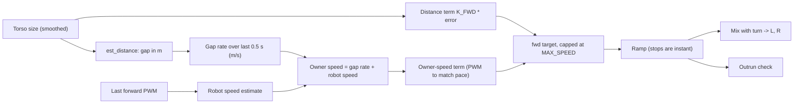

<!-- 707eedec-c007-47bb-9449-22e9c5c8429e -->
---
todos:
  - id: "constants"
    content: "Add dynamic-speed constants (ROBOT_TOP_SPEED, VEL_WINDOW, OWNER_MOVING, VEL_GAIN, RAMP_UP/DOWN, OUTRUN_*) to follower.py"
    status: pending
  - id: "helpers"
    content: "Add pure helpers gap_rate, owner_speed, pace_term, ramp_fwd, mix"
    status: pending
  - id: "follow-cmd"
    content: "Change follow_command to return (fwd_target, turn, driving) with the pace term, keeping the hysteresis stop rule"
    status: pending
  - id: "main-loop"
    content: "Main loop: distance history, owner speed, ramp, instant stops, resets, outrun check via on_outrun() hook, hint and STATUS fields"
    status: pending
  - id: "tests"
    content: "Update T4-T10 and add T12-T19 in test_follow.py; run them"
    status: pending
  - id: "hw-plan"
    content: "Write the hardware calibration/test steps (ROBOT_TOP_SPEED, walk tests, outrun test, tuning table)"
    status: pending
  - id: "docs"
    content: "Update idealfeatures.md, features.md, CLAUDE.md status and defend line"
    status: pending
isProject: false
---
# Dynamic Speed (feature 7): Implementation Plan

## Idea

Today the forward command is only the distance error: `fwd = K_FWD * (TARGET_TORSO - size)`. That is pure proportional control, so a walking owner is always followed with a lag: the robot only speeds up after the gap has already grown. Dynamic speed adds a second term based on how fast the owner is walking, so the robot matches their pace before the gap opens.



Key point for the defence: the camera measures the **relative** speed (owner minus robot). When the robot is already driving, the gap barely changes even though the owner is walking. So the owner's speed is the gap rate **plus** the robot's own estimated speed. The robot's speed comes from the last forward PWM and one calibrated number, `ROBOT_TOP_SPEED`.

## 1. Constants in [follower.py](follower.py)

Add these after `MIN_SPEED`:

```python
ROBOT_TOP_SPEED = 0.5    # m/s, robot ground speed at MAX_SPEED; measure in step 6!
VEL_WINDOW = 0.5         # s of gap history used to estimate the owner's speed
OWNER_MOVING = 0.15      # m/s, owner speeds below this count as standing still (noise)
VEL_GAIN = 0.8           # 0..1, share of the owner's pace matched by the speed term (below 1 = no overshoot)
RAMP_UP = 250            # PWM/s, max forward speed increase (MIN_SPEED -> 200 in ~0.5 s)
RAMP_DOWN = 500          # PWM/s, max forward speed decrease while still driving (full stops are instant)
OUTRUN_DIST = 2.5        # m, gap that counts as "owner got away"
OUTRUN_TIME = 1.5        # s at near-full speed with gap > OUTRUN_DIST before giving up
```

Change the `est_distance` docstring: it is now also used for control, but only through its **rate of change**. Calibration errors scale the rate but do not flip its sign.

## 2. New pure helpers (testable without a camera)

- `gap_rate(history)`: `history` is a list of `(t, dist)` pairs. Returns `(d_last - d_first) / (t_last - t_first)` in m/s, or `None` if the span is under `0.6 * VEL_WINDOW` or there are fewer than 3 samples. Using the window endpoints instead of frame-to-frame differences keeps detection noise at 10 FPS manageable.
- `owner_speed(rate, fwd_prev)`: `rate + ROBOT_TOP_SPEED * fwd_prev / MAX_SPEED` (owner speed away from the camera, in m/s), or `None` if `rate` is `None`.
- `pace_term(v_owner)`: `VEL_GAIN * MAX_SPEED * v_owner / ROBOT_TOP_SPEED` if `v_owner > OWNER_MOVING`, otherwise `0`. Never negative: an owner walking towards the robot does not make it reverse (feature 8 handles that separately).
- `ramp_fwd(prev, target, dt)`:
  - `target <= 0` returns `0` immediately, because stopping is never ramped (safety).
  - `prev < MIN_SPEED` (starting from a stop) jumps to `min(target, MIN_SPEED)` floored at `MIN_SPEED`, so the motors don't stall during the ramp.
  - Otherwise `prev + clamp(target - prev, -RAMP_DOWN * dt, RAMP_UP * dt)`.
- `mix(fwd, turn)`: returns `shape_speed(fwd + turn), shape_speed(fwd - turn)`.

## 3. Change `follow_command`

New signature `follow_command(box, W, size, driving, v_owner)`, which returns `(fwd_target, turn, driving)` instead of `L, R`. Mixing moves to `mix()` after the ramp.

- The hysteresis and "torso hidden: steer only" rules stay exactly as they are.
- `fwd_target = min(MAX_SPEED, max(K_FWD * (TARGET_TORSO - size), MIN_SPEED) + pace_term(v_owner)) if driving else 0`.
- The stop rule is unchanged: at `TARGET_TORSO` the robot stops even if the owner is moving. This keeps "still stops at 1 m" and "never closer than target" guaranteed by the same code as today.

## 4. Main loop changes

- New state next to `size_s, driving`: `dist_hist = deque()`, `fwd_cmd = 0.0`, `v_owner = None`, `outrun_since = None`, `outran = False`.
- **Reset** all of these wherever `size_s, driving = None, False` is reset today (lock, re-lock, lost, unlock).
- **Owner-visible branch**, after `size` is computed:
  - If `size` is not `None`, append `(now, est_distance(size))` and drop entries older than `VEL_WINDOW`. If `size` is `None`, clear the history, because an old window would give a fake rate.
  - Compute `v_owner = owner_speed(gap_rate(dist_hist), fwd_cmd)`.
  - Compute `fwd_target, turn, driving = follow_command(box, W, size, driving, v_owner)`.
  - Compute `fwd_cmd = ramp_fwd(fwd_cmd, fwd_target, dt)`, then `left, right = mix(fwd_cmd, turn)`.
- **Unlock gesture held, or owner not visible**: set `fwd_cmd = 0` (immediate stop, same as today).
- **Outrun check** (in the owner-visible branch):
  - Condition: `fwd_cmd >= 0.9 * MAX_SPEED` and `est_distance(size) > OUTRUN_DIST`. Start `outrun_since` when it first holds; clear it as soon as it doesn't.
  - If the condition holds for `OUTRUN_TIME`: log `[OUTRUN] owner faster than robot (gap ~X m at full speed) -> stopped`, then set `state = "LOST"`, `outran = True`, `fwd_cmd = 0`.
  - While `outran` is set, the owner being visible does **not** return the robot to FOLLOW. Motors stay at 0 with the hint `"Too fast for me - come back within 2.5 m"`. `outran` clears (and logs `[FOUND]`) once the owner's estimated gap is below `OUTRUN_DIST`. The unlock gesture still works.
  - Put all of this in one small function, `on_outrun()`, with a short comment that it switches to SEARCH once feature 9 exists. That is the only line to change later.
- **Display and log**:
  - FOLLOW hint: append `f"  owner {v_owner:+.1f} m/s"` when it is known.
  - `[STATUS]` line: add `ov=<m/s or ->` and `fwd=<fwd_cmd:.0f>`. These are the numbers the floor tests read from `follower.log`.

Size check: `follower.py` grows from about 415 to about 490 lines, just under the ~500-line split threshold in `CLAUDE.md`. If it goes over, move the control helpers into `control.py` as the convention says.

## 5. Offline tests in [test_follow.py](test_follow.py)

Update T4 to T10 for the new `follow_command` return value (pass `v_owner=None` and check `fwd_target`/`turn`/`driving`, or run them through `mix`). Then add:

- T12 `gap_rate`: samples going 1.0, 1.1 and 1.2 m over 0.4 s give 0.5 m/s. A span that is too short gives `None`.
- T13 `owner_speed`: rate 0 with `fwd_prev = MAX_SPEED` gives `ROBOT_TOP_SPEED`, because the robot is keeping pace.
- T14 `pace_term`: below `OWNER_MOVING`, or negative, gives 0. An owner speed equal to `ROBOT_TOP_SPEED` gives `VEL_GAIN * MAX_SPEED`.
- T15 Walking owner: the same small error with `v_owner = 0.4` gives a larger `fwd_target` than with `v_owner = None`, capped at `MAX_SPEED`.
- T16 Still stops: `size = TARGET_TORSO`, `driving=True`, `v_owner = 0.5` gives `fwd_target == 0` and `driving == False`.
- T17 Ramp up: from 0 to 200 the first step gives `MIN_SPEED`, and the next step at `dt = 0.1` gives `MIN_SPEED + 25`.
- T18 Ramp stop: from 180 to a target of 0 gives 0 immediately.
- T19 Ramp down while driving: from 200 to a target of 100 at `dt = 0.1` gives 150.

## 6. Hardware calibration and tests (add as a section to [distance_plan.md](distance_plan.md) or a new short `speed_plan.md`)

1. **Measure `ROBOT_TOP_SPEED`**: set the robot to drive straight at `MAX_SPEED` (use `motor_test.py`), time it over 2 m on the floor, and repeat 3 times. Speed in m/s = 2 / mean time. Set the constant.
2. **Tethered, wheels off the ground**: walk slowly away and check that `ov=` in the log matches the walk (about 0.5 to 1 m/s) and that `fwd=` climbs smoothly without jumps.
3. **Floor, 5 runs each** (measure the final gap the same way as in `distance_plan.md`): slow walk, normal walk, brisk walk, each 3 m straight and then stop. For each run, record the stop gap, the largest gap while walking, and whether it jerked.
4. **Compare** against a run with `VEL_GAIN = 0`, which turns the pace term off. Dynamic speed should cut the largest gap while walking, and the stop gap should stay within the ±20 % pass band.
5. **Outrun test**: brisk-walk or jog away. Expect `[OUTRUN]` in the log, the robot stopped, and the "come back" hint. Step back within 2.5 m and expect FOLLOW again.
6. **Tuning, one value at a time**:
   - Overshoots on stopping: lower `VEL_GAIN` or `RAMP_UP`.
   - Robot surges when the owner sways: raise `OWNER_MOVING` or `VEL_WINDOW`.
   - Feels sluggish: raise `RAMP_UP`.

## 7. Docs

- [idealfeatures.md](idealfeatures.md) feature 7, [features.md](features.md) and [CLAUDE.md](CLAUDE.md): status planned to built (needs tuning). Also add the relative-speed point and the measured `ROBOT_TOP_SPEED` to the defend line.
- `CLAUDE.md` architecture box: mention the speed term and ramp under P-control.
