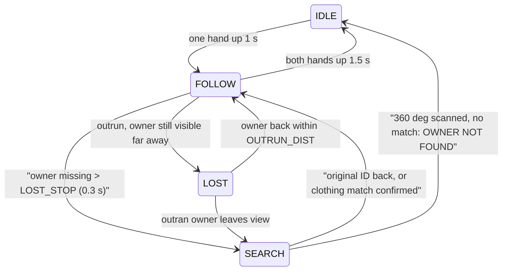

<!-- 707eedec-c007-47bb-9449-22e9c5c8429e -->
---
todos:
  - id: "control-search"
    content: "control.py: SEARCH_* constants and pure Search class (stop-and-look, time-based angle, hold)"
    status: pending
  - id: "perception"
    content: "Split keypoint/hands_up/torso_hist/torso_ratio into perception.py; add best_match(); update imports"
    status: pending
  - id: "main-search"
    content: "follower.py: SEARCH state transitions, confirmed re-lock, give-up to IDLE, outran->SEARCH, --no-search"
    status: pending
  - id: "overlay"
    content: "Overlay: SEARCH colour, SEARCHING / OWNER NOT FOUND banners, hint, search= in STATUS"
    status: pending
  - id: "tests"
    content: "test_follow.py T29-T34; run all tests"
    status: pending
  - id: "motor-test"
    content: "motor_test.py item 11 search spin calibration"
    status: pending
  - id: "docs"
    content: "search_plan.md hardware tests; update CLAUDE.md, idealfeatures.md, features.md, speed_plan.md"
    status: pending
isProject: false
---
# Owner Search (feature 9): Implementation Plan

## Behaviour



**Stop-and-look, not a continuous spin.** The robot turns `SEARCH_STEP_DEG` (30 degrees, about half the camera's horizontal field of view), then holds still for `SEARCH_LOOK` seconds. YOLO and the clothing histogram work badly on motion-blurred frames, so matching only happens while the robot is still. 12 steps make a full 360 degrees.

**No wheel encoders or IMU,** so the angle is time-based: `step_time = SEARCH_STEP_DEG / SPIN_DEG_PER_S`, where `SPIN_DEG_PER_S` is measured once at `SEARCH_SPEED` on the demo floor. The demo only needs a roughly complete circle; the error is defended as a known limit.

**Direction:** the sign of the owner's last `centre_error`. Last seen on the right means turn right (`mix(0, +SEARCH_SPEED)` gives left forward, right backward, the same convention as steering).

**Stricter re-lock while searching:** a stranger with similar clothes is the main risk. In SEARCH, a clothing match must reach `REID_THRESH` on the **same track ID** for `SEARCH_CONFIRM` consecutive frames. While a candidate is being confirmed, the robot holds still (the look phase restarts). The original owner ID reappearing counts as found immediately.

**Safety:** speed is only ever `mix(0, ±SEARCH_SPEED)`, which is rotation in place with no forward or backward motion. The Arduino's obstacle block (`l + r > 0`) is never triggered by a pure spin, and the 500 ms watchdog still applies because commands are sent every frame. The CLAUDE.md rule "never move when the owner is not visible" becomes: "never drive forward or backward when the owner is not visible; the only motion allowed without the owner is slow in-place rotation in SEARCH". A `--no-search` flag keeps the old behaviour (stop in LOST and wait).

## 1. [control.py](control.py): constants and pure search logic

```python
SEARCH_SPEED = 90        # PWM per side for in-place rotation (slow; just above MIN_SPEED)
SPIN_DEG_PER_S = 90.0    # deg/s at SEARCH_SPEED on the demo floor; measure it (search test S0)!
SEARCH_STEP_DEG = 30     # deg turned between looks (about half the camera's horizontal view)
SEARCH_LOOK = 0.7        # s standing still after each step so detection and re-ID see sharp frames
SEARCH_CONFIRM = 3       # consecutive frames a clothing match must hold before re-locking in SEARCH
```

`class Search` (pure, the time is passed in):
- `__init__(direction, now)`: sets `dir = +1 / -1`, `turned = 0`, `phase = "look"` and `phase_start = now`. It starts with a look, so the robot first checks the current view while stopped.
- `step(now, hold=False)`: returns `(turn_pwm, done)`.
  - `hold` (a candidate is being confirmed) sets the phase to `"look"` and `phase_start = now`, and returns 0.
  - A finished look switches to `"turn"`, unless `turned >= 360`, in which case it returns `done=True`.
  - A finished turn (`now - phase_start >= SEARCH_STEP_DEG / SPIN_DEG_PER_S`) adds `SEARCH_STEP_DEG` to `turned` and switches back to `"look"`.
  - Returns `dir * SEARCH_SPEED` during a turn and 0 during a look.
- `progress()`: returns `turned` in degrees, for the overlay and logs.

## 2. Split out [perception.py](perception.py)

`follower.py` is about 460 lines now, and SEARCH adds about 60, which would pass the ~500-line convention. Move `keypoint`, `hands_up`, `torso_hist` and `torso_ratio` (plus the keypoint index and `KP_CONF` constants) to `perception.py`. Add one new helper there:

- `best_match(frame, people, owner_hist)`: returns `(person or None, score or None)`. This is the existing re-ID loop from the main loop, moved as-is.

Update the imports in [follower.py](follower.py) and [test_follow.py](test_follow.py) (`torso_ratio`, keypoint indices).

## 3. [follower.py](follower.py) main loop

New state: `search = None`, `candidate = (None, 0)` (track id, consecutive-frame count), `last_err = 0.0` (the owner's last `centre_error`, updated every frame the owner is visible), and `not_found_until = 0.0` (how long the IDLE banner stays up).

- **FOLLOW, owner missing:** keep the immediate clothing re-lock during the 0.3 s grace period, as today. After `LOST_STOP`:
  - Normally: `state = "SEARCH"`, `search = Search(+1 if last_err >= 0 else -1, now)`, `fs = FollowState()`, and the log line `[SEARCH] owner lost -> scanning, turning right/left first`.
  - With `--no-search`: the old `LOST` behaviour.
- **LOST with `outran`, owner disappears for more than `LOST_STOP`:** go to SEARCH as well. `outran` stays set, so if they are found but still far away, the existing outrun wait applies.
- **SEARCH branch** (each frame):
  1. Original `owner_id` in `people`: log `[FOUND] owner id X after N deg -> FOLLOW`, then `state = "FOLLOW"` and `search = None`.
  2. Otherwise `p, score = best_match(...)`. If `score >= REID_THRESH`, count consecutive frames for the same id in `candidate`. At `SEARCH_CONFIRM`, log `[RE-LOCK] ... during search`, set `owner_id = p[0]`, and go to FOLLOW. While counting, use `hold=True`.
  3. Compute `turn, done = search.step(now, hold)`, then `left, right = mix(0, turn)`.
  4. If `done`: log `[SEARCH] 360 deg scanned, owner not found -> IDLE`. Then `state = "IDLE"`, clear `owner_id` and `owner_hist`, `cooldown_until = now + COOLDOWN`, `not_found_until = now + 3`, `left = right = 0`.
  5. Hint: `f"Searching... {search.progress():.0f}/360 deg"`, plus the best match score when one is known.
- **Unlock** is not possible in SEARCH (the owner isn't visible). Lock gestures only work again in IDLE.
- **Overlay:**
  - Add `"SEARCH": (0, 200, 255)` (yellow/orange, BGR) to `STATE_COLOURS`.
  - Bottom banner: `SEARCHING FOR OWNER` in SEARCH, and `OWNER NOT FOUND` in IDLE while `now < not_found_until`.
  - The existing `LOST` banner stays for the outrun wait.
- **`[STATUS]`:** add `search=<deg>/360` while searching.
- **Argument parser:** add `--no-search` with the help text "stop and wait instead of rotating to find a lost owner".
- **Feature 7 hook:** `on_outrun()` keeps returning `"LOST"` (the owner is still visible). Update its docstring: the robot goes to SEARCH once the outran owner leaves view.
- **Feature 15 hook** (LED/buzzer, not built): log events are the only signal for now. Put the state changes in one place so `S,<n>` can be sent from there later.

## 4. Offline tests in [test_follow.py](test_follow.py)

- T29 the search starts in look, and `turn == 0` during the first `SEARCH_LOOK`.
- T30 after the look, the turn phase gives `turn == dir * SEARCH_SPEED`, for both directions.
- T31 one turn lasts `SEARCH_STEP_DEG / SPIN_DEG_PER_S`, then `progress()` gives 30.
- T32 stepping the clock through 12 turn+look cycles gives `done == True` at 360, never before, and `turn == 0` when done.
- T33 `hold=True` mid-turn gives `turn == 0`, the phase becomes look, and `progress()` doesn't increase.
- T34 `best_match` with fake histograms picks the highest correlation and returns `(None, None)` for an empty `people` list. Fake frames: two solid-colour images and boxes.

## 5. [motor_test.py](motor_test.py)

New item **11. Search spin calibration**: spin right at `SEARCH_SPEED` (imported from `control.py`) for 4 s. Print "measure the angle turned; SPIN_DEG_PER_S = angle / 4". Marking the floor or using a phone compass both work.

## 6. Hardware tests: new [search_plan.md](search_plan.md)

- **S0 calibration (floor):** run item 11 three times, average, and set `SPIN_DEG_PER_S`. Then a check: run a full search with nobody in view and make sure the robot ends within about ±45 degrees of where it started. If not, adjust `SPIN_DEG_PER_S`.
- **Laptop (no `--port`):** lock, step out of view, and expect SEARCH with a progress count. Step back in within the scan time and expect `[FOUND]`. Stay out and expect `OWNER NOT FOUND`, then IDLE after about 12 x (step + look) seconds.
- **Tethered, wheels off the ground:**
  - X1: step out to the left. The wheels spin to turn left first.
  - X2: step out to the right. They spin to turn right first.
  - X3: the robot holds still during each look.
- **Floor:**
  - X4: the owner steps behind the robot. It turns, finds them, and FOLLOW resumes.
  - X5: a stranger in different clothes stands in view. No re-lock, and the scan continues.
  - X6: a stranger in similar clothes. Record whether a false re-lock happens. If it does, raise `SEARCH_CONFIRM` or `REID_THRESH`.
  - X7: nobody returns. A full turn, then IDLE and the banner.
  - X8: an obstacle 15 cm away during the spin. It still turns in place (allowed) and never drives forward.
- **Results sheet:** `SPIN_DEG_PER_S`, end-angle error, time to find, false re-locks.

## 7. Docs

- [CLAUDE.md](CLAUDE.md):
  - State machine `IDLE -> FOLLOW <-> SEARCH -> IDLE`.
  - New file `perception.py` in the Files list.
  - Features row "Owner search".
  - Reworded safety convention (in-place rotation in SEARCH is the only motion without the owner).
- [idealfeatures.md](idealfeatures.md) feature 9 and [features.md](features.md) item 13: mark as built (needs testing). Describe stop-and-look, the time-based angle, the confirmed re-lock and `--no-search`. Extend the defend line with "angle is time-based (no encoders), calibrated per floor".
- [speed_plan.md](speed_plan.md) outrun step: the outran owner leaving view now triggers SEARCH.
