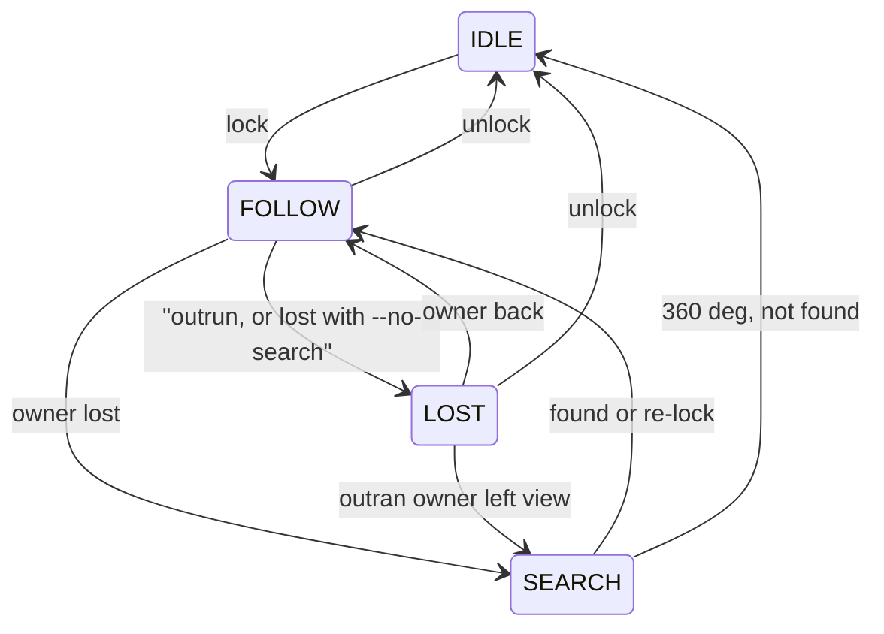

<!-- 707eedec-c007-47bb-9449-22e9c5c8429e -->
---
todos:
  - id: "table"
    content: "control.py: STATES, TRANSITIONS, transition_allowed()"
    status: pending
  - id: "change-state"
    content: "follower.py: change_state() replaces on_state_change/prev_state; route every state assignment through it with a reason"
    status: pending
  - id: "tests"
    content: "test_follow.py T35-T37 (allowed, illegal, reachability); run all tests"
    status: pending
  - id: "verify"
    content: "Grep for direct state assignments; run fake-camera simulation and check [STATE] lines, no ILLEGAL"
    status: pending
  - id: "docs"
    content: "Update CLAUDE.md, idealfeatures.md, features.md"
    status: pending
isProject: false
---
# State Machine: Transition Table (feature 10)

## Why

Today `state = "..."` is assigned at about 12 places in [follower.py](follower.py), and a state change is only noticed at the end of the frame (`prev_state` vs `state` calls `on_state_change`). Nothing checks that a change is legal. Also, two changes in one frame (for example LOST -> FOLLOW -> LOST at an outrun) show up as none.

After this change:
- Every change goes through `change_state()`.
- Each change is checked against one table.
- Each change is logged with its reason.

That backs up the defence line "one clear state at a time, easy to debug from the log": a reviewer can read the table and grep `[STATE]` in `follower.log`.

## The table



Anything else is illegal, for example IDLE -> SEARCH, IDLE -> LOST or SEARCH -> LOST.

## 1. [control.py](control.py): table and pure check

Add these at the end, in a new "state machine" section:

```python
STATES = ("IDLE", "FOLLOW", "SEARCH", "LOST")
TRANSITIONS = {
    ("IDLE", "FOLLOW"): "lock",
    ("FOLLOW", "IDLE"): "unlock",
    ("FOLLOW", "SEARCH"): "owner lost",
    ("SEARCH", "FOLLOW"): "owner found",
    ("SEARCH", "IDLE"): "search gave up",
    ("FOLLOW", "LOST"): "outrun / lost with --no-search",
    ("LOST", "FOLLOW"): "owner back",
    ("LOST", "SEARCH"): "outran owner left view",
    ("LOST", "IDLE"): "unlock",
}


def transition_allowed(old, new):
    return old == new or (old, new) in TRANSITIONS
```

## 2. [follower.py](follower.py): one function for every change

Replace `on_state_change(old, new)` with:

```python
def change_state(old, new, reason):
    """The only way the state changes: checks the table, logs it, and is the hook for the status LED/buzzer."""
    if new == old:
        return old
    if not transition_allowed(old, new):
        log.error(f"[STATE] ILLEGAL {old} -> {new} ({reason}) - bug, please report the log")
    log.info(f"[STATE] {old} -> {new} ({reason})")
    return new
```

**An illegal change is still applied, but logged as ERROR.** Refusing it would leave the other variables (`owner_id`, `search`, `fs`) inconsistent with the state. Safety doesn't depend on this check: IDLE, LOST and SEARCH never drive forward, and the Arduino watchdog and obstacle rules still apply. The offline tests and the log catch bugs.

Then:
- Remove `prev_state` and the end-of-frame `if state != prev_state` block.
- Turn every `state = X` assignment into `state = change_state(state, X, "<reason>")`. The sites and reasons:
  - Lock: `f"lock id {pid}"`
  - Unlock (from FOLLOW or LOST): `f"unlock by id {owner_id}"`
  - FOLLOW -> SEARCH: `f"owner not seen for {LOST_STOP}s"`
  - LOST -> SEARCH (outran): `"outran owner left view"`
  - FOLLOW -> LOST, `--no-search`: `"owner lost, --no-search"`
  - Outrun: `on_outrun()` keeps returning `"LOST"`, and the call site becomes `change_state(state, on_outrun(gap), f"outrun, gap ~{gap:.1f} m")`
  - SEARCH -> FOLLOW: `f"owner id {owner_id} back after {deg} deg"` or `f"clothing match id {best[0]}"`
  - SEARCH -> IDLE: `"360 deg scanned, not found"`
  - Owner-visible branch: `state = "LOST" if outran else "FOLLOW"` becomes `change_state(state, ..., "owner visible")`. This is a no-op when the state is unchanged, and LOST -> FOLLOW when the outrun ends.
- Update the module docstring: add a short "States" paragraph listing the four states and pointing to `TRANSITIONS` in `control.py`. Update the `state = "IDLE"` comment the same way.

The existing event lines (`[LOCK]`, `[SEARCH]`, `[FOUND]`, ...) stay. `[STATE]` lines are the compact timeline. No change to the overlay or the `[STATUS]` format.

## 3. Offline tests in [test_follow.py](test_follow.py)

- T35 every edge in the diagram is allowed, and so is staying in the same state.
- T36 illegal changes are rejected: IDLE -> SEARCH, IDLE -> LOST, SEARCH -> LOST, and an unknown state name.
- T37 every state in `STATES` is reachable from IDLE, and every state has a path back to IDLE (simple graph walk over `TRANSITIONS`). This proves the robot can never get stuck in a state with no way out.

## 4. Check

- `python test_follow.py`: all tests pass.
- `rg "state = \"" follower.py` returns nothing (every change goes through `change_state`).
- Run the main loop with a scripted fake camera and fake YOLO once, in a temporary script outside the repo (as was done for feature 9). Lock, lose, search, re-lock, then give up. Check that `follower.log` shows exactly one `[STATE]` line per change and no `ILLEGAL`.

## 5. Docs

- [CLAUDE.md](CLAUDE.md): change the architecture line to `IDLE -> FOLLOW <-> SEARCH -> IDLE (+ LOST: outrun wait)`. Add a convention: "change state only via `change_state()`; add new states/edges to `TRANSITIONS` in `control.py`." Spin Mode will need new edges later.
- [idealfeatures.md](idealfeatures.md) feature 10 and [features.md](features.md) item 12: mention the transition table, the `[STATE] old -> new (reason)` log lines, and T35 to T37. Extend the defend line: "illegal changes are logged as ERROR; tests prove every state can return to IDLE".
