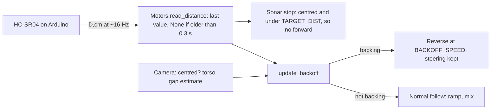

<!-- 707eedec-c007-47bb-9449-22e9c5c8429e -->
---
todos:
  - id: "firmware"
    content: "Arduino: non-blocking D,<cm> telemetry after each ping; header comment"
    status: pending
  - id: "motor-test"
    content: "motor_test.py: drain input in run(), add item 10 ultrasonic readout"
    status: pending
  - id: "control"
    content: "control.py: back-off constants, centre_error, parse_distance, update_backoff, FollowState fields"
    status: pending
  - id: "motors-read"
    content: "follower.py Motors.read_distance() and per-frame call"
    status: pending
  - id: "main-loop"
    content: "follower.py main loop: sonar stop, back-off branch, logs, us= in STATUS"
    status: pending
  - id: "tests"
    content: "test_follow.py T20-T28 (steering, parser, back-off rules); run all"
    status: pending
  - id: "hw-docs"
    content: "Rewrite distance_plan.md Phase 7 as telemetry + back-off tests; update CLAUDE.md, idealfeatures.md, features.md, arduino.md"
    status: pending
isProject: false
---
# Steering and Minimum Distance (feature 8): Implementation Plan

## Current state

- **Steering is done:** `follow_command` in [control.py](control.py) computes `turn = K_TURN * err_x`, with `CENTER_DEADBAND` stopping wobble near the centre. `DEADBAND` (hysteresis) stops wobble near the target distance. Only tests and docs are missing.
- **Back-off is missing:** the robot never reverses. Python has no close-range distance, because the torso cue loses the hips below about 1 m. The Arduino measures the front distance (`distCm`, every 60 ms) but only uses it internally.

## Design



Back-off rules (all must hold to **start**):
1. The owner is visible and in FOLLOW (not unlocking, not outran). Reversing never happens without the owner in view.
2. The owner is roughly centred, `abs(err_x) < BACKOFF_CENTER`. The sonar beam is narrow and straight ahead, so the reading is about the owner only when they are in front.
3. There is a fresh sonar reading under `MIN_DIST_CM` (60 cm).
4. **Camera cross-check:** the torso is hidden (normal when the owner is this close) or the torso estimate is under `TARGET_DIST`. If the camera says the owner is far, the sonar is seeing an obstacle, so the robot stops and does not reverse.

**Keep** backing while the reading is under `BACKOFF_CLEAR_CM` (75 cm, hysteresis) and the episode is shorter than `BACKOFF_MAX_TIME`. After the time cap, stay stopped until the reading goes above `BACKOFF_CLEAR_CM`. There's no rear sensor, so reversing is slow and short by design.

**Sonar stop** (from `distance_plan.md` Phase 7): when the owner is centred and the reading is under `TARGET_DIST * 100` cm, the forward target is forced to 0. This guards against a miscalibrated `TARGET_TORSO` and never makes the robot move.

## 1. Firmware: [motor_controller/motor_controller.ino](motor_controller/motor_controller.ino)

After each ping in `loop()`, send the distance without blocking (if the host isn't reading, a full TX buffer must not stall motor control or the watchdog):

```cpp
if (Serial.availableForWrite() >= 8) { Serial.print("D,"); Serial.println(distCm); }
```

`999` keeps meaning "no echo / nothing within about 4 m". Add `"D,<cm>\n" sent to the Pi after every ping` to the header comment. The 20 cm forward block stays exactly as it is.

## 2. Bench tool: [motor_test.py](motor_test.py)

- In `run()`, call `ser.reset_input_buffer()` each loop so incoming `D,` lines don't pile up.
- New menu item **10. Ultrasonic readout**: print the latest `D,` value 5 times a second for 10 s, with the motors stopped. This is used to check the sensor against a tape measure.

## 3. [control.py](control.py)

New constants:

```python
MIN_DIST_CM = 60         # cm, back off when the centred owner is closer than this (sonar)
BACKOFF_CLEAR_CM = 75    # cm, stop backing off once the owner is this far (hysteresis)
BACKOFF_SPEED = 80       # PWM, slow reverse (just above MIN_SPEED)
BACKOFF_MAX_TIME = 2.0   # s, longest reverse per episode: there is no rear sensor
BACKOFF_CENTER = 0.25    # |err_x| below this counts as "owner in front of the sonar"
SONAR_MAX_AGE = 0.3      # s, older sonar readings are ignored
```

New helpers:
- `centre_error(box, W)`: the existing `err_x` formula, moved out of `follow_command`, which now calls it.
- `parse_distance(buf)`: takes the received text buffer and returns `(last_cm or None, leftover partial line)`. Only `D,<int>` lines count; anything else is ignored. Pure, so it can be tested offline.
- `update_backoff(fs, us_cm, centred, cam_dist, now)`: applies the rules above using new `FollowState` fields `backing`, `backoff_start` and `backoff_wait` (time cap hit, waiting for clear). Returns `True` while reversing, and logs nothing itself.

## 4. `Motors` class in [follower.py](follower.py)

- `read_distance()`: if there's no port, return `None`. Otherwise read `ser.in_waiting` bytes (non-blocking, `timeout=0` already set), feed them through `parse_distance`, store `(cm, time)`, and return `cm` if it is newer than `SONAR_MAX_AGE`, otherwise `None`.
- Call it **once per frame at the top of the loop** in every state, so the buffer is always drained.

## 5. Main loop in [follower.py](follower.py) (FOLLOW branch, not outran, not unlocking)

```python
err_x = centre_error(box, W)
centred = abs(err_x) < BACKOFF_CENTER
fwd_target, turn, fs.driving = follow_command(box, W, size, fs.driving, fs.v_owner)
if us is not None and centred and us < TARGET_DIST * 100:
    fwd_target, fs.driving = 0.0, False          # sonar stop
if update_backoff(fs, us, centred, gap, now):
    fs.fwd = -BACKOFF_SPEED                      # not ramped; owner_speed() then sees the robot moving back
    hint = f"Too close ({us} cm) - backing off"
else:
    fs.fwd = ramp_fwd(fs.fwd, fwd_target, dt)
left, right = mix(fs.fwd, turn)
```

- `ramp_fwd` already handles a negative `prev` (a start from back-off begins at `MIN_SPEED`). Every other path (lost, unlock, outrun) keeps setting `fs.fwd = 0` / a new `FollowState`, which also ends any back-off instantly.
- Log events: `[BACKOFF] owner at X cm -> reversing`, `[BACKOFF] done at X cm`, `[BACKOFF] time limit, waiting for owner to step back`, and `[SONAR] obstacle at X cm but camera says owner ~Y m -> stop, no reverse` (rate-limited to the status interval).
- Add `us=<cm or ->` to the `[STATUS]` line.
- Size check: `follower.py` grows by about 40 lines (to about 460) and `control.py` by about 50.

## 6. Offline tests in [test_follow.py](test_follow.py)

- T20 steering deadband: owner slightly off centre gives `turn == 0`.
- T21 steering direction: owner on the left gives right > left. This complements T9 for the right side.
- T22 `parse_distance`: `"D,45\nD,4"` gives `(45, "D,4")`. Junk lines are ignored, and `999` passes through.
- T23 back-off starts: 50 cm, centred, `cam_dist=None` gives `True`.
- T24 not centred gives `False`.
- T25 camera says 2.0 m (obstacle) gives `False`.
- T26 stale or `None` reading gives `False`.
- T27 hysteresis: while backing, 70 cm keeps `True`, and 80 cm gives `False`.
- T28 time cap: after `BACKOFF_MAX_TIME` gives `False`, still `False` at 50 cm, and `True` again only after a reading above `BACKOFF_CLEAR_CM` followed by one under 60 cm.

## 7. Hardware tests: rewrite Phase 7 of [distance_plan.md](distance_plan.md) as "Ultrasonic telemetry and back-off"

- **Bench:** `motor_test.py` item 10 at 30, 60 and 100 cm against a tape measure, checked on a flat board and on a person wearing a sweater. Note how soft clothing affects the reading. Then rerun items 8 and 9 (watchdog and obstacle stop still work).
- **Tethered, wheels off the ground:**
  - B1: stand at 50 cm centred. Wheels reverse slowly and `[BACKOFF]` appears in the log.
  - B2: step back to 80 cm. Reversing stops.
  - B3: stay at 50 cm. Reversing stops after 2 s, the "waiting" log line appears, and the robot doesn't restart until you step back past 75 cm and close in again.
  - B4: stand 50 cm away but off to the side. No reverse.
  - B5: put a box at 50 cm while the owner stands at 2 m behind it. The robot stops and doesn't reverse, and the `[SONAR]` log line appears.
  - B6: raise both hands at 50 cm. Wheels stop (unlock pause).
- **Floor:** 5 runs where the owner walks towards the stopped robot and stops at about 0.4 m. Record the final gap (expected 0.6 to 0.8 m) and the reverse distance (expected under 0.5 m).

## 8. Docs

- [CLAUDE.md](CLAUDE.md): change the serial protocol line to two directions (`M,<l>,<r>` to the Arduino, `D,<cm>` back at about 16 Hz). Add a features-table row for "Steering + minimum distance".
- [idealfeatures.md](idealfeatures.md) feature 8 and [features.md](features.md) item 5: describe the sonar back-off, and extend the defend line with "reversing is blind, so it is slow, at most 2 s, only with the owner centred and the camera agreeing".
- [arduino.md](arduino.md): mention the `D,` telemetry and `motor_test.py` item 10.
